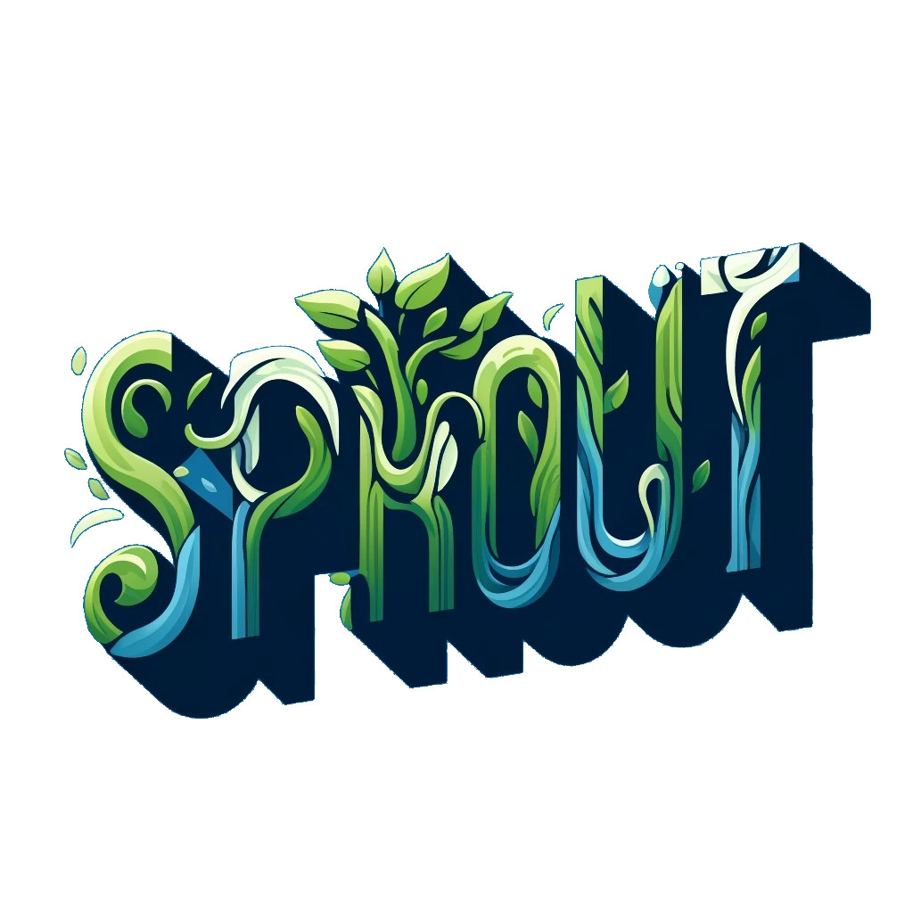

::: {.callout-tip}  
## Reasoning  

I am a researcher at the Department of Botany, Charles University, dedicated to providing students with knowledge and skills in reproducible, open, and collaborative science. My courses are designed to foster teamwork skills, critical thinking, and innovative research methodologies.  
:::  

## Mentoring  

Are you a student at the Department of Botany struggling with the complexities of ecological data? I'm here to assist you in analysing ecological data for your project.  

More information in [EN](/about_me/student_mentoring_en.qmd) / [CZ](/about_me/student_mentoring_cz.qmd).  

## Courses I currently teach

::: {.callout-note appearance="simple" icon="false"}

### 🌱 SPROuT

#### SPROuT – Science Powered through Reproducibility, Openness, and Teamwork 

📍 **Location:** Seminarium, Department of Botany  
🎓 **Credits:** 3 ECTS  
💻 **Format:** Practical, group-based sessions in RStudio (bring your own laptop)  
🎯 **Course Code:** 

##### Description 

**SPROuT** is a five-day, hands-on workshop focused on mastering the principles of **reproducibility**, **openness**, and **teamwork** in scientific research.  
Designed for **master’s and PhD students**, the course offers a practical and engaging approach to building modern research workflows using **R**, **Git/GitHub**, and **Quarto**.  

Participants will learn how to organise their projects efficiently, write clean and reproducible code, manage their work with version control, collaborate effectively within research teams, and publish transparent, reproducible results. Through interactive group-based sessions in **RStudio**, students will gain the confidence to apply Open Science practices in their own research—making their work more robust, collaborative, and shareable.

##### Daily Themes
1. **Organise** – Set up your project structure, manage your environment, and learn the principles of Open Science.  
2. **Analyse** – Write readable, reproducible, scalable R code with good coding etiquette.  
3. **Save** – Implement version control with Git/GitHub to track, protect, and manage your research.  
4. **Collaborate** – Learn to work in teams using GitHub for transparent project collaboration.  
5. **Publish** – Communicate and share your research openly.

##### Expected Learning Outcomes

* Understand the principles of Open Science 🌐 and reproducibility ♻️.  
* Apply best practices for data and project organisation 🗂️.  
* Use Git/GitHub for version control 📚.  
* Manage projects and collaborate using GitHub 🧑‍💼.  
* Create reproducible reports using Quarto 📜.  
* Share research openly following FAIR principles and modern publishing standards 🔓.  

##### Advertisements

 

 

 
:::

___

::: {.callout-note appearance="simple" icon="false"}

### 📊 Biostatistics for biologists

#### Statistics in biology and design of ecological experiments

🎓 **Credits:** 5 ECTS \
🎯 **SIS Course Code:** 

##### Expected Learning Outcomes

* **Distinguish among variable types** and select appropriate numerical summaries and graphical displays 📊.
* **Translate a biological or ecological question into a model** by identifying the response and predictor variables 🧩.
* **Use the linear model** as a fundamental analytical tool 📈.
* **Interpret linear-model parameters** ($a$, $b$) and assess the strength of a relationship ($R^2$) 🔎.
* **Interpret effect estimates and uncertainty**, including confidence intervals 🎯.
* **Interpret p-values** in context 🧪.
* **Assess model assumptions** and determine whether they are satisfied ✅.
* **Work with multiple predictors** and explain the consequences of correlated predictors 🧮.
* **Recognise and interpret interactions** between predictors 🔀.
* **Compare candidate models using AIC** and justify the choice of a final model ⚖️.
* **Recognise nonlinearity** and select a simple solution, such as a transformation or an appropriate functional form 📉.
* **Recognise hierarchical data structures**, including repeated measurements, sites, and blocks, and determine when the model needs to be extended 🧱.
* **Select an appropriate model for categorical responses** and explain why a linear model (`lm`) is unsuitable for binary data (0/1) 🔢.
* **Construct a complete analytical workflow in R**: data import → visualisation → modelling → diagnostics → interpretation ♻️.
:::

___

::: {.callout-note appearance="simple" icon="false"}

### 🌍 SSOQE

#### Science School on Quantitative Ecology 

🎓 **Credits:** 5 ECTS \
🎯 **SIS Course Code:** 

More info on the project's [**websites**](https://bit.ly/SSoQE).

##### Description

I am a co-founder and organiser of this annual Czech-German school, supported through three funding rounds. It is an intensive five-day international workshop designed for master's and motivated PhD students. The school provides hands-on training in statistical modelling 📊, computational techniques 💻, and data analysis. It alternates between the Czech Republic and Germany, offering a dynamic learning environment led by lecturers from Charles University, the University of Bayreuth, and guest experts 🌟.

##### Expected Learning Outcomes

* Gain expertise in statistical modelling and data analysis for ecological datasets 📈.
* Participate in hands-on projects led by esteemed lecturers and guest experts 👨‍🏫👩‍🏫.
* Network with peers and experts through formal and informal sessions 🗣️.
* Learn contemporary methods and concepts in Quantitative Ecology 🌿.
:::

___

::: {.callout-note appearance="simple" icon="false"}

### 🎓 Seminars of Vegetation science

#### Seminar for PhD students

🎓 **Credits:** 1 ECTS \
🎯 **SIS Course Code:** 

##### Expected Learning Outcomes

* **Formulate and communicate the research clearly**, including objectives, hypotheses, methods, and expected or achieved results, with the focus adapted to the current year of PhD study 🎯.
* **Explain the wider relevance of the project** in an ecological and geobotanical context for an audience across study levels 🌍.
* **Design and deliver a structured scientific talk** within the allocated time, balancing presentation and discussion 🎤.
* **Present methods and results clearly** so that the key messages and uncertainties are evident 📊.
* **Identify focused questions for discussion**—conceptual, methodological, or interpretative—and share them in advance ❓.
* **Engage constructively in scientific discussion** and use questions, criticism, and questionnaire feedback to refine research design, analyses, and manuscripts 💬.
* **Demonstrate progression through the PhD**, from the initial project outline to progress reports and near-complete or submitted manuscripts 🧭.
* **Contribute to a supportive scholarly community** by providing collegial, constructive feedback to peers 🤝.

#### Diploma thesis seminar (geobotany) II

🎓 **Credits:** 1 ECTS \
🎯 **SIS Course Code:** 

##### Expected Learning Outcomes

* **Describe the main stages of a diploma-thesis project**—from formulating questions to interpreting results—and relate them to the seminar presentations delivered during the master's programme 🗺️.
* **Formulate clear and meaningful research questions**, distinguish known from unknown aspects of the problem, and explain their relevance ❓.
* **Develop a realistic work plan** covering data, collection strategy, methods, expected contribution, principal risks, and contingency plans 🗓️.
* **Prepare and deliver a clear scientific presentation** within the allocated time, introducing the context, objectives, methods, results to date, and next steps 🎤.
* **Organise collected data effectively** into clear tables, figures, and structured text linked to both original and newly emerging questions 📊.
* **Critically discuss research projects**, identify weaknesses in design, data collection, analysis, or interpretation, and propose realistic improvements 🔍.
* **Respond constructively to feedback**, distinguish fundamental concerns from technical comments, and use both to strengthen the thesis 💬.
* **Adapt presentation format and language to the audience**, including non-Czech-speaking colleagues, while following academic communication principles 🌐.
* **Reflect on the project's development** across successive presentations and evaluate changes in questions, data, analyses, and interpretation 🧭.

:::

___

::: {.callout-note appearance="simple" icon="false"}

### 💡CodeFest

#### CodeFest - Innovating Together for a Better University Environment

🎓 **Credits:** 2 ECTS \
🎯 **SIS Course Code:** 

##### Description

CodeFest is a three-day workshop 💻 where master's and PhD students collaborate to develop tools 🛠️ that enhance the university's educational and environmental framework. Participants will engage in team projects 👥 with roles in design, project management, and documentation, promoting creativity and cooperation 🌟. Prior coding knowledge is not required, as an optional GitHub introduction session is offered.

🗓️**Date**: The date will be selected based on the participants' availability. I will contact you after you register.

##### Expected Learning Outcomes

* Develop innovative solutions to improve the university environment 🌍.
* Gain experience in software development and project management 🚀.
* Learn diverse roles like project management, design 🎨, and review♻️.
:::

